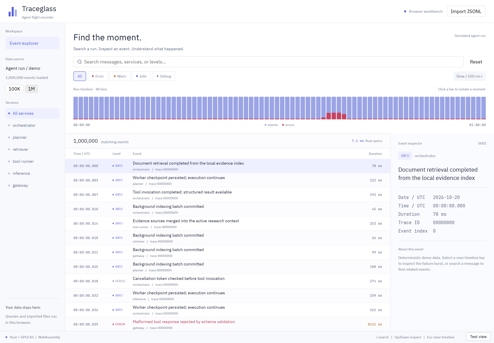

# Traceglass

A browser-based event explorer built with Rust, GPUI Kit, and WebAssembly.
Explore a million simulated agent events, find an incident on the timeline, and inspect the records behind it.



## Try it

[Open the live demo](https://traceglass.2-38.com).

Select **1M**, click the red burst on the timeline, then narrow the results with **Error** or a search for `timeout`. Select a row to inspect its timestamp, duration, trace ID, and original JSON.

- Switch between 100,000 and 1,000,000 deterministic demo events.
- Combine text, service, severity, duration, and time filters.
- Navigate an 80-bin timeline and a virtualized event list.
- Import a local JSONL file, including Japanese messages.
- Use **Text view** for standard HTML controls and the first 20 results.
- See the measured Rust query time after each filter change.

The demo uses synthetic data. It does not connect to a live agent system.

## How it works

```text
Cloudflare Workers Static Assets
  └─ HTML + JavaScript loader + WebAssembly
       ├─ GPUI Kit → WebGPU / WebGL2 → canvas
       └─ event-core → filtering, aggregation, timeline, JSONL import
```

The browser runs the WebAssembly application; Cloudflare serves its static assets.
The UI uses GPUI Kit 0.7.3. The independent [`event-core`](crates/event-core) crate
compiles for both native Rust and WebAssembly.

The demo stores compact records and shares message templates instead of
duplicating strings for each event. Text matches are cached by template before
scanning records, and the UI renders only visible rows. Queries currently run
synchronously in WebAssembly on the browser's main thread.

## Performance

A recorded Chromium 141 run over 1,000,000 simulated events measured a **4.2 ms
median** and **7.3 ms p95** across 30 warm query samples. These timings cover
Rust filtering and aggregation only. They exclude input handling, rendering,
network transfer, and first-load compilation.

The synthetic dataset uses shared templates; real JSONL with diverse messages
has different memory and processing costs. This is an experiment, not a claim
of universal browser performance or a measured frame-rate guarantee.
See [validation results, methodology, and limitations](VALIDATION.md).

## Run locally

Install Rust through `rustup`, plus Node.js 22 or newer and npm.
The repository pins its Rust toolchain and dependency lockfiles.

```sh
git clone https://github.com/kandotrun/traceglass.git
cd traceglass
rustup toolchain install nightly-2026-10-20 --profile minimal --target wasm32-unknown-unknown
cargo install wasm-bindgen-cli --version 0.2.121 --locked
npm ci
npm run check
npm run build
npm run dev
```

Open [localhost:8793](http://localhost:8793). The `wasm-bindgen` CLI must match
the pinned crate version, **0.2.121**.

## Import JSONL

Choose **Import JSONL** and select a local file, or try [`web/sample.jsonl`](web/sample.jsonl).
Each nonblank line must contain one JSON object:

```json
{"timestamp":"2026-10-20T09:00:00Z","level":"error","service":"retriever","message":"Upstream timeout","duration_ms":1500,"trace_id":"run-42"}
```

`timestamp` (RFC 3339 with a timezone, or integer epoch milliseconds) and
`message` are required. `timestamp_ms` is also accepted. Severity, service,
duration, and trace ID are optional; extra fields remain available in the
original JSON inspector. Records are stably sorted by timestamp and displayed
in UTC.

Limits are **32 MiB per file**, **1,000,000 events**, **256 KiB per line**,
**16 KiB per message**, and **256 services**. An invalid import preserves the
current dataset.

Search applies whitespace-separated AND terms to message, service, and severity.
ASCII matching ignores case; non-ASCII matching is exact. Trace IDs and arbitrary
JSON fields are not searchable. String trace IDs receive a numeric display hash;
the original value remains in the JSON inspector. See the
[core format reference](crates/event-core/README.md) for aliases and edge cases.

File contents are processed in the browser tab and are not uploaded by the app.
There is no account, telemetry integration, or persistent log store. Reloading
discards imported data.

## Test

```sh
npm run check
npx playwright install chromium
npm run dev
# In a second terminal:
npm run test:e2e
```

The browser suite exercises the actual WebAssembly module, filters, JSONL
import, invalid-input recovery, mobile-width controls, and query measurements.
For visual verification, use `npx playwright test --headed`; headless GPU
screenshots can retain stale frames on some systems.

Set `TRACEGLASS_URL` to test another deployment. `TRACEGLASS_REPORT` and
`TRACEGLASS_SCREENSHOT` select the benchmark report and screenshot destinations.

## Deploy

Use a Cloudflare account with Workers enabled. Review `wrangler.jsonc` and set
the Worker name and any route for your own account before deploying.

```sh
npx wrangler login
npx wrangler whoami
npm run build
npx wrangler deploy --dry-run
npm run deploy
```

Credentials do not belong in this repository. Workers Static Assets hosts the
application; no server-side log processing or database is required.

## Scope and attribution

GPUI Kit's WebAssembly support is experimental. WebGPU was verified in Chromium;
WebGL2 fallback, Safari, Firefox, and physical mobile devices have not been
validated. Text view offers standard HTML controls, but this is not a complete
accessibility conformance claim.

Built with [GPUI Kit](https://gpui-kit.com/docs/webassembly/) and
[Cloudflare Workers Static Assets](https://developers.cloudflare.com/workers/static-assets/).
Dependency, font, and icon notices are in
[THIRD-PARTY-NOTICES.md](THIRD-PARTY-NOTICES.md). Third-party licenses apply to
their respective components; a license for Traceglass's original code has not
yet been selected.
